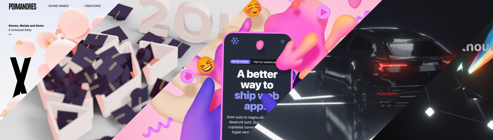

# LuxLeaf Scene Kit — source guide

**The complete React Three Fiber project, organized for exploration and local development.**

[Quick start](#quick-start) · [Usage](#usage) · [Examples](#examples) · [Packages](#packages) · [Verification](#verification)



*Upstream artwork retained with the original project. The original [README](readme.md), source and notices remain unchanged.*

This guide covers the `faithful-upstream` branch in [PR #1](https://github.com/Zontafor/luxleaf-scene-kit/pull/1). It restores the pinned original implementation to the repository root. For the published `@zontafor/luxleaf-scene-kit` API, use the [main-branch guide](https://github.com/Zontafor/luxleaf-scene-kit/blob/main/README.md).

## Quick start

Use Node 24 and Yarn 1.22.22. The source uses React 19 with Fiber 9.

```sh
git clone --branch faithful-upstream https://github.com/Zontafor/luxleaf-scene-kit.git
cd luxleaf-scene-kit
yarn install --frozen-lockfile --ignore-scripts
yarn run postinstall
yarn build
yarn examples
```

Open the Vite address printed in the terminal. `postinstall` creates the original workspace development links and builds the original reconciler patch.

## Usage

Create a React component in the example application. The source workspace retains the upstream package name:

```tsx
import { Canvas } from '@react-three/fiber';

export function ExampleScene() {
  return (
    <div style={{ height: 360 }}>
      <Canvas camera={{ position: [0, 0, 4] }}>
        <ambientLight intensity={1.2} />
        <directionalLight position={[3, 4, 5]} intensity={3} />
        <mesh rotation={[0.4, 0.5, 0]}>
          <boxGeometry args={[1.5, 1.5, 1.5]} />
          <meshStandardMaterial color="#77b299" roughness={0.3} />
        </mesh>
      </Canvas>
    </div>
  );
}
```

A canvas needs a sized parent. Add behavior with `useFrame`, load assets with `useLoader`, and attach pointer handlers to meshes. These hooks run inside the canvas's React tree.

## Examples

After starting the gallery, choose a scene in its navigation:

| Example | What to explore | Source |
|---|---|---|
| Click and hover | Pointer events and interactive objects | [ClickAndHover](example/src/demos/ClickAndHover.tsx) |
| GLTF | Model loading | [Gltf](example/src/demos/Gltf.tsx) |
| Portals | Rendering into a separate scene | [Portals](example/src/demos/Portals.tsx) |
| Multiple views | Several views of scene content | [MultiView](example/src/demos/MultiView.tsx) |
| Disposal | Object lifetime and disposal | [AutoDispose](example/src/demos/AutoDispose.tsx) |

Browse the complete [example directory](example) for the remaining scenes. Linked source is inspectable on GitHub; rendering happens in the local gallery.

## Packages

| Package | Purpose |
|---|---|
| [Fiber](packages/fiber) | Reconciler, canvas, events, hooks and scene types |
| [Native](packages/fiber/native) | Native entry point; requires a React Native host |
| [Test renderer](packages/test-renderer) | Scene-graph testing helpers |
| [ESLint plugin](packages/eslint-plugin) | Rules for render-loop usage |

## Verification

```sh
node .luxleaf/verify-source.mjs
yarn test --runInBand --watchman=false
yarn workspace example build
```

The pinned tree includes 228 original files. Local validation passed 282 tests and 14 snapshots, with one upstream TODO. [Recorded verification](.luxleaf/verification.json) separates builds from unverified native-device and browser combinations. Source-file counts alone do not establish runtime parity.

## Source and license

Pinned revision: `d74622ea8ed717f7212d7e19d65ff3e325508389`. The [manifest](.luxleaf/upstream-manifest.json) verifies original bytes, with original GitHub workflows relocated to `.luxleaf/upstream-workflows/`. [Development architecture](docs/development/CORE.md) and [contributing instructions](CONTRIBUTING.md) remain available.

Original Fiber authorship and the [MIT license](LICENSE) are retained. This fork does not relicense the original implementation as proprietary LuxLeaf code.
