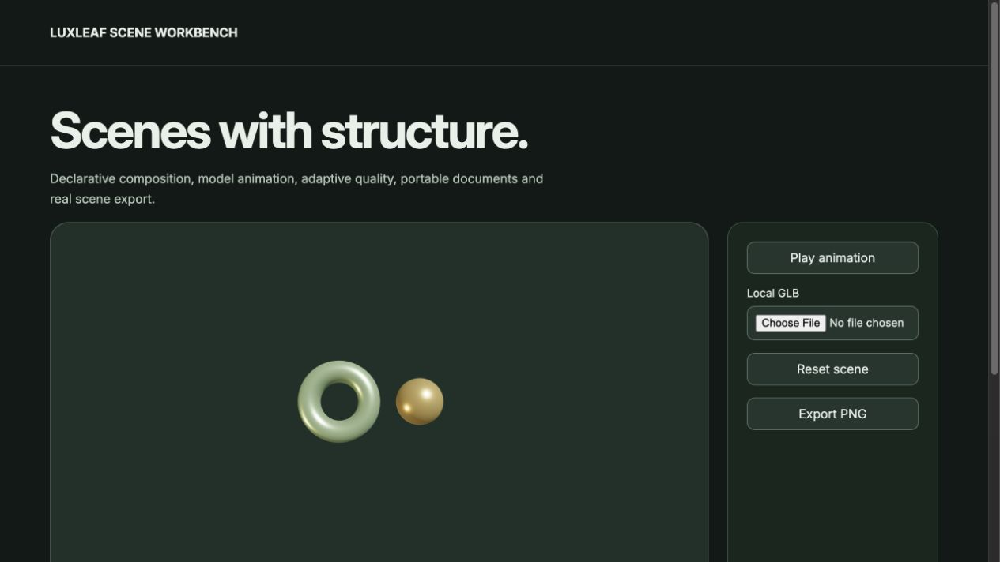

# LuxLeaf Scene Kit

**Compose interactive 3D scenes in React, load models, and keep scene data portable.**

[Quick start](#quick-start) · [Examples](#examples) · [API guide](#api-guide) · [Run the demos](#run-the-demos) · [Documentation](#documentation)



*Actual package workbench. [View its source](demo/advanced.tsx); run `/advanced.html` using the instructions below. This is a screenshot, not a hosted live demo.*

## At a glance

- React components for lit, orbitable scenes and selectable primitives.
- Full Fiber, native, test-renderer and ESLint entry points.
- GLB loading, model cloning, animation controls and adaptive rendering quality.
- Validated scene documents, asset lifecycle tools and PNG capture.

**Release covered:** `@zontafor/luxleaf-scene-kit@0.2.0` on `main`. [PR #1](https://github.com/Zontafor/luxleaf-scene-kit/pull/1) contains newer work; its [source-branch guide](https://github.com/Zontafor/luxleaf-scene-kit/blob/faithful-upstream/LUXLEAF.md) uses the APIs available on that branch. The examples below use the published package, unless explicitly labeled otherwise.

## Quick start

Node 24+ for this repository; React 19 and a browser with WebGL for web examples. Give every canvas a parent with an explicit height.

### Install in an application

Configure GitHub Packages authentication as described in the [release and registry guide](docs/RELEASING.md). Scope the registry to LuxLeaf so other dependencies continue to resolve from their normal registry:

```sh
npm config set @zontafor:registry https://npm.pkg.github.com --location=project
npm install @zontafor/luxleaf-scene-kit@0.2.0
```

Keep credentials outside committed source. [GitHub Releases](https://github.com/Zontafor/luxleaf-scene-kit/releases) also provide package archives; downloading an archive is separate from installing through the registry.

### Try the repository locally

```sh
git clone https://github.com/Zontafor/luxleaf-scene-kit.git
cd luxleaf-scene-kit
npm ci --ignore-scripts
npm run build
npm run dev
```

Open the local address printed by Vite. React examples below belong in a React/TypeScript application; plain TypeScript examples run in a browser with a bundler.

## Examples

### Interactive React scene

```tsx
import { useState } from 'react';
import { SceneCanvas, SceneObject } from '@zontafor/luxleaf-scene-kit';

export function ProductPreview() {
  const [gold, setGold] = useState(false);
  return (
    <div style={{ height: 360 }}>
      <SceneCanvas>
        <SceneObject
          options={{ shape: 'torus', color: gold ? '#e4c477' : '#b7dba7', speed: 0.25 }}
          onSelect={() => setGold(value => !value)}
        />
      </SceneCanvas>
    </div>
  );
}
```

Drag to orbit, hover to enlarge the object, and click to change its color. `SceneCanvas` supplies lighting and handles its render loop.

### Load a GLB model

```tsx
import { SceneCanvas, Model } from '@zontafor/luxleaf-scene-kit';

export function ModelPreview() {
  return (
    <div style={{ height: 420 }}>
      <SceneCanvas animate={false}>
        <Model url="/models/product.glb" />
      </SceneCanvas>
    </div>
  );
}
```

Supply your own model at `public/models/product.glb` in a Vite application. The model must fit the camera view; the loader does not automatically frame every asset. For local file intake and model replacement, see the runnable workbench.

### Use the Fiber API directly

```tsx
import { Canvas } from '@zontafor/luxleaf-scene-kit/fiber';

export function CustomScene() {
  return (
    <div style={{ height: 320 }}>
      <Canvas camera={{ position: [0, 0, 4] }}>
        <ambientLight intensity={1.2} />
        <directionalLight position={[3, 4, 5]} intensity={3} />
        <mesh rotation={[0.4, 0.5, 0]}>
          <boxGeometry args={[1.5, 1.5, 1.5]} />
          <meshStandardMaterial color="#77b299" roughness={0.3} />
        </mesh>
      </Canvas>
    </div>
  );
}
```

Use this entry point when you want direct control of the scene graph and lighting.

## API guide

| Entry or symbol | Purpose |
|---|---|
| `SceneCanvas` | React canvas with lighting, motion preferences and optional orbit controls. |
| `SceneObject` | Validated sphere, box or torus; optional selection callback. |
| `Model` | GLTF/GLB model loaded by URL. |
| `validate / serialize / deserialize` | Validate and round-trip SceneOptions. |
| `/fiber · /native · /testing · /eslint` | Foundation APIs; native execution needs a React Native host. |

### Common options

| Option | Default | Accepted values |
|---|---|---|
| `shape` | `torus` | sphere, box, torus |
| `color` | `#b7dba7` | Six-digit hex color |
| `speed` | `0.25` | 0–2 |
| `roughness / metalness` | `0.3 / 0.65` | 0–1 |
| `animate` | `true` | Boolean |

## Run the demos

After `npm run dev`, append a route below to the local Vite address. These links point to checked-in source; GitHub does not execute the demos itself.

| Local route | Example | Source |
|---|---|---|
| `/` | Compact example | [React entry](demo/main.tsx) |
| `/advanced.html` | Full workbench shown above | [Workbench](demo/advanced.tsx) |
| `/checks.html` | Base browser checks | [Check page](demo/checks.html) |
| `/checks-expanded.html` | Expanded browser checks | [Check page](demo/checks-expanded.html) |

## Development and verification

```sh
npm run verify          # Type checks, tests, build, and foundation checks where defined
npm run verify:package  # Inspect and import the built package archive
```

Open the browser check pages separately and use their Run button. [Validation notes](docs/VALIDATION.md) distinguish automated checks, browser observations and remaining host verification. Passing checks does not certify complete upstream or cross-device parity.

### Integration notes

Native-device execution and every browser/GPU combination remain unverified. The source restoration in PR #1 is a separate branch and does not change the published package shown here.

## Documentation

| Guide | What it covers |
|---|---|
| [Capabilities](docs/CAPABILITIES.md) | Implemented features and current limits |
| [Architecture](docs/ARCHITECTURE.md) | Rendering, state and resource lifecycle |
| [Validation](docs/VALIDATION.md) | Checks and their scope |
| [Releases](docs/RELEASING.md) | Registry authentication, archives and release verification |
| [Provenance](docs/PROVENANCE.md) | Foundation boundaries and original additions |
| [Security](SECURITY.md) | Supported deployment assumptions |
| [Changelog](CHANGELOG.md) | Release history |

## License and attribution

Original LuxLeaf code, documentation and examples are covered by the [proprietary license](LICENSE), copyright **Michelle L. Wu**. Included third-party software retains its own licenses and authorship; see [third-party notices](THIRD_PARTY_NOTICES.md). Public repository visibility does not grant rights beyond those licenses.
