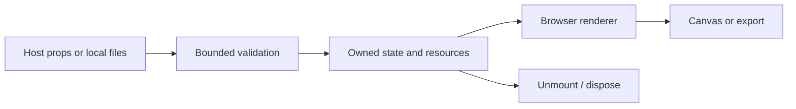

# Architecture — v0.2.0

### Rendering ecosystem

The complete Fiber API is available at `/fiber`; `/native` and `/testing` expose the corresponding foundation entry points. The unmodified 228-file reference tree preserves its core, reconciler, hooks, native implementation, test renderer, lint rules, tests, examples and docs.

### LuxLeaf scene tools

Versioned scene documents, strict transforms/material validation, skeleton-aware model cloning, reference-counted asset cache, animation playback, adaptive DPR, error boundaries and PNG capture.

### Developer workbench

Local embedded GLB import, scene JSON editor, animation controls, model replacement resource disposal and a real rendering acceptance page.

### Remaining host verification

React Native/Expo device builds, host bundler combinations, complete upstream test suite, and a broad browser/GPU performance matrix are not certified.

## Processing flow



## Foundation boundary

LuxLeaf extension code lives in `src/`. Permitted reference source is preserved separately where included. Host-specific adapters are separate entry points. The browser library does not supply application-wide authorization or tenant isolation.

## Earlier core design notes

# LuxLeaf Scene Kit: architecture

```text
React props → strict preset validation → LuxLeaf scene composition → React Three Fiber reconciler → Three.js resources → browser WebGL
```

The host owns the page, authentication, layout and model URLs. LuxLeaf supplies product defaults, motion policy, preset validation, a basic model loader and orbit lifecycle. Fiber owns React reconciliation and event dispatch; Three owns scene geometry, materials and GPU resources.

`SceneCanvas` creates a perspective camera at [0, 0, 4], ambient light and two directional lights. React mounts `SceneObject` geometries declaratively; Fiber reconciles replacements and handles their disposal. Orbit listeners are installed in an effect and removed on cleanup. `Model` clones the scene hierarchy while retaining the loader cache; it deliberately uses `dispose={null}` to avoid disposing shared cached assets. The host must manage cache eviction for long-lived asset catalogs. This helper does not correctly duplicate animated skinned models; use a skeleton-aware loader pipeline for those assets.

Animation uses frame delta capped at 50 ms. The motion hook listens to reduced-motion and document-visibility changes. A paused canvas uses demand frames; changes and orbit interactions invalidate the canvas. The package does not detect offscreen scenes or impose a scene-wide polygon, texture or draw-call budget. Applications with many canvases should virtualize them and share assets.

A WebGL-unavailable fallback is supplied. Suspense handles pending assets; consumers should put an error boundary around the scene to handle failed model URLs and decoder errors. Canvas-only content needs an equivalent accessible description and controls in the host DOM. The demo's controls are native HTML.

## Trust boundary

Preset JSON enters a strict whitelist validator before it changes rendering state. The library does not evaluate code, render imported HTML, request credentials or contact an application backend. Dependencies are pinned in the lockfile; preserved runtime license texts ship in `third_party/`. Treat dependency installation as a separate network operation from running the demo.

## Integration with LuxLeaf's wider system

This package belongs in the presentation layer. Keep provider credentials, authorization, metering, workflow execution and document access on the existing server side. Store only validated, bounded presets through the host application's authorized tenant-scoped API. Do not infer permissions from visual state or embed secrets in presets. That API connection is an integration contract, not a backend implemented by this repository.

Build the library as ESM and bundle it with the authorized host application. The included demo is a static build in `demo-dist/`; an approved internal static host can serve it. No infrastructure is automatically provisioned and no cloud credentials are required.
